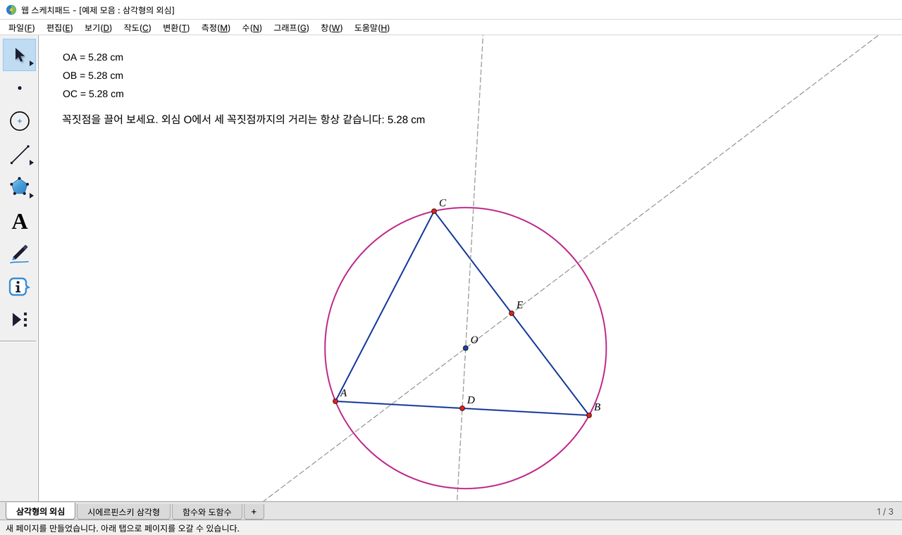

# 웹 스케치패드 (WebGSP)

The Geometer's Sketchpad 5(GSP5)의 작도 방식과 화면 배치를 웹 브라우저로 옮긴 **동적 기하 작도 프로그램**입니다.
설치 없이 `index.html` 파일 하나로 동작하며, 인터넷 연결이 없어도 쓸 수 있습니다.



## 바로 써 보기

- **내 컴퓨터에서:** `index.html`을 내려받아 크롬·엣지·웨일 등에서 열면 됩니다.
- **GitHub Pages로 공개하면:** `https://<사용자이름>.github.io/<저장소이름>/` 주소로 누구나 접속할 수 있습니다(아래 안내 참고).
- **예제:** [`examples/예제모음.wgsp`](examples/)를 내려받아 **파일 › 열기**로 불러오면 삼각형의 외심, 시에르핀스키 삼각형, 함수와 도함수 세 페이지를 볼 수 있습니다.

## GSP5와 같은 점

- 메뉴막대 `파일(F) 편집(E) 보기(D) 작도(C) 변환(T) 측정(M) 수(N) 그래프(G) 창(W) 도움말(H)`과 왼쪽 9개 도구상자
- 선택 방식: 클릭하면 선택에 추가, 선택된 개체를 다시 클릭하면 해제, 빈 곳을 클릭하면 모두 해제, 겹친 개체는 반복 클릭으로 차례 선택
- 메뉴 명령은 **실행 조건**(선택한 개체의 종류와 개수)이 맞을 때만 켜지고, 상태 표시줄에 선택 내용이 나옵니다
- 점을 두 번 클릭하면 중심 지정, 선을 두 번 클릭하면 대칭축 지정

## 기능

| 영역 | 기능 |
|---|---|
| 도구 | 화살표(이동·회전·닮음), 점, 원, 선(선분·반직선·직선), 다각형(내부·내부와 변·변), 글(이름·글상자), 펜(각 표시·선 표시·손그림), 정보, 사용자 도구 |
| 파일 | 새 스케치, 열기·저장(.wgsp), 닫기, **여러 페이지**(아래 탭), 문서 설정, 사진 가져오기, PNG·SVG 내보내기, 인쇄 설정·인쇄 |
| 편집 | 실행 취소·다시 실행, 잘라내기·복사·붙여넣기(페이지 사이도 가능), 동작 버튼(숨기기/보이기·애니메이션·이동·동시/연결 실행·소리·바로가기·화면이동), 모두/상위/하위 개체 선택, 분리/병합, 사진 자르기, 정의 편집, 속성, 선택사항 |
| 보기 | 점·선 모양, 색, 가변색, 문자열 서식, 숨기기, 이름 보이기·바꾸기, 스크립트 보기, 흔적, 애니메이션과 애니메이션 제어판 |
| 작도 | 도형 위의 점, 중점, 교점, 선분·반직선·직선, 평행선, 수선, 각의 이등분선, 원 2가지, 호 2가지, 다각형·원·부채꼴·활꼴 내부, 자취 |
| 변환 | 중심·대칭축·각·비율·벡터·거리 지정, 평행이동, 회전이동, 닮음변환, 선대칭이동, 반복(기하·수치, 여러 사상), 사용자 정의 변환 |
| 측정 | 길이, 거리, 둘레, 원둘레, 각, 넓이, 중심각, 호의 길이, 반지름, 비율, 점의 위칫값, 좌표, x·y 좌표(극좌표의 r·θ), 좌표상의 거리, 기울기, 방정식 |
| 수 | 매개변수, 계산기, 표(자료 추가·삭제), 새 함수, 미분하기(기호 미분), 그림으로 함수 정의 |
| 그래프 | 좌표계 정의(여러 개 가능)·좌표계 지정, 격자 형태(정사각형·직사각형·극좌표), 점선 격자, 격자에 맞추기, 좌표로 점 찍기, 위칫값으로 점 찍기, 표의 자료로 점 찍기, 함수의 그래프, 매개변수 함수의 그래프 |
| 글상자 | 가변 문자열(측정값을 넣으면 값이 따라 바뀜), 수식 표기(`x^2`→x², `a_1`→a₁, `sqrt(`→√), 수학 기호 단추 |

## 자주 쓰는 키

| 키 | 동작 |
|---|---|
| Esc | 작업 취소 → 화살표 도구 → 선택 해제 → 애니메이션 정지 → 흔적 지우기 |
| Ctrl+L / Ctrl+M / Ctrl+I / Ctrl+P | 선분 / 중점 / 교점 / 다각형 내부 |
| Ctrl+H / Ctrl+K | 숨기기 / 이름 보이기 |
| Ctrl+Z / Ctrl+R | 실행 취소 / 다시 실행 |
| Del | 선택 개체와 하위 개체 지우기 |
| Shift+↑↓ / Shift+←→ | 도구 바꾸기 / 세부 도구 바꾸기 |
| + / − | 매개변수 값, 반복 횟수, 자취 세밀도 바꾸기 |
| Tab | 가까운 개체 선택 |
| Alt+끌기, 스페이스+끌기 | 화면 이동 |
| Shift+Ctrl+N | 새 페이지 |

크롬에서는 Ctrl+N·Ctrl+T(흔적 남기기)를 브라우저가 먼저 가져가므로 메뉴를 이용하세요.

## GitHub Pages로 공개하기

1. 이 폴더의 파일을 모두 저장소에 올립니다(`index.html`이 저장소 맨 위에 있어야 합니다).
2. 저장소의 **Settings → Pages**에서 *Source*를 `Deploy from a branch`, 브랜치를 `main`, 폴더를 `/ (root)`로 정하고 **Save**를 누릅니다.
3. 1~2분 뒤 `https://<사용자이름>.github.io/<저장소이름>/`에서 열립니다.

## 폴더 구조

```
index.html        배포용 단일 파일 (build.py가 만듦)
build.py          src/ 를 묶어 index.html 을 만드는 스크립트
src/
  shell.html      화면 골격과 스타일
  1_geom.js       기하 계산 (교점, 경로 매개화, 호)
  2_expr.js       수식 파서, 계산, 기호 미분
  3_model.js      문서 모델, 의존 그래프, 개체별 계산, 측정, 자취, 반복
  4_render.js     캔버스 그리기, 선택 표시, 좌표계·표
  5_ui.js         도구, 마우스 입력, 끌기, 애니메이션, 상태 표시줄
  6_cmds.js       작도·변환·측정·수·그래프·편집 명령, 사용자 도구
  7_app.js        메뉴, 대화상자, 도구상자, 키보드
  8_pages.js      여러 페이지(탭), 문서 열기·저장
  9_more.js       사진, 동작 버튼, 애니메이션 제어판, 가변색, 표 그래프, 사용자 정의 변환
  y_extra.js      다중 좌표계, 가변 문자열, 그림으로 함수 정의, 스크립트 보기, 고급 선택사항
  z_start.js      시작
examples/         예제 파일과 화면 그림
```

## 고쳐서 다시 만들기

`src/`의 파일을 고친 뒤 다음을 실행하면 `index.html`이 새로 만들어집니다(Python 3, 외부 패키지 없음).

```bash
python3 build.py
```

## 저장 파일

- 작업 내용은 브라우저에 자동 저장되며, **파일 › 저장**으로 `.wgsp` 파일(모든 페이지 포함, JSON 형식)을 만들 수 있습니다.
- 사용자 도구는 사용자 도구(▶) 메뉴에서 `.wgst` 파일로 내보내고 가져올 수 있습니다.
- GSP5의 `.gsp` 파일은 형식이 공개되어 있지 않아 열 수 없습니다.

## 알아 둘 점

- 도움말 메뉴의 "GSP5 참조 센터"는 `index.html`을 GSP5 설치 폴더(예: `D:\Sketchpad`)에 두고 열었을 때만 연결됩니다. GSP5 매뉴얼은 저작권이 있으므로 이 저장소에 포함하지 않습니다.
- 이 프로그램은 GSP5의 작도 방식을 참고해 새로 만든 것으로, The Geometer's Sketchpad 및 그 제작사와 관련이 없습니다. 도구 아이콘도 새로 그렸습니다.
- 지원하지 않는 GSP5 기능: 학습 자료 연결, `.gsp` 파일 열기.
